# Introduction 

**CWLed**: A Graphical Editor for Common Workflow Language (CWL) Documents
**by K.Mavrommatis**


The development of complex data analysis pipelines, particularly in bioinformatics, relies on ensuring reproducibility and portability. The Common Workflow Language (CWL) has emerged as a critical standard for describing these workflows, but its syntax can be verbose and complex. Manually authoring CWL documents is often a tedious and error-prone process, requiring developers to have an in-depth understanding of the specification's intricate details. This complexity creates a significant barrier for many researchers and creates a clear need for a specialized editor that can abstract away the boilerplate, validate the code in real-time, and provide a more intuitive interface for workflow construction.

CWLed was developed to address this need, providing a powerful and user-friendly graphical interface for creating and editing CWL tools and workflows. Its primary utility lies in simplifying the development process by allowing users to visually construct complex pipelines without needing to write CWL code by hand. By offering features like form-based editors for tool parameters, and access to cwl validation tools, it lowers the barrier to entry for creating standards-compliant, reproducible workflows. This enables scientists and developers to focus on the logic of their analysis rather than the intricacies of CWL syntax, ultimately accelerating scientific discovery.

The architecture of CWLed is designed for flexibility, catering to both visual-oriented users and those who prefer to work directly with code. Its core feature is a dual-view system that seamlessly integrates a graphical workflow editor with a raw CWL code editor. Users can build a pipeline by dragging and connecting nodes in the graph view, and the corresponding CWL code is automatically generated in the background. Conversely, any changes made directly in the code view are immediately reflected in the visual graph. This hybrid approach allows for rapid prototyping and high-level management in the GUI, while still providing developers with the fine-grained control and power of direct code editing.


# Table of Contents

- [Introduction](#introduction)
- [Table of Contents](#table-of-contents)
- [Installation](#installation)
  - [MacOS](#macos)
  - [Linux](#linux)
  - [Manual](#manual)
  - [Integration with LLMs](#integration-with-llms)
- [Usage](#usage)
- [Main Window](#main-window)
  - [Side Panel](#side-panel)
  - [Document Tabs](#document-tabs)
  - [Detached Windows](#detached-windows)
  - [Comparing Documents](#comparing-documents)
  - [Remote Folders (SSH)](#remote-folders-ssh)
  - [Welcome Tab](#welcome-tab)
  - [Status Bar](#status-bar)
  - [Themes](#themes)
- [Command Line tool Editor](#command-line-tool-editor)
  - [Document Toolbar](#document-toolbar)
  - [App Info Tab](#app-info-tab)
  - [Visual Editor Tab](#visual-editor-tab)
    - [Inspector](#inspector)
    - [Expression Editor](#expression-editor)
    - [Command Line Preview](#command-line-preview)
  - [Code Tab](#code-tab)
- [Workflow Editor](#workflow-editor)
  - [App Info Tab](#app-info-tab-1)
  - [Visual Editor Tab](#visual-editor-tab-1)
    - [Step Inspector](#step-inspector)
  - [Summary Tab](#summary-tab)
  - [Code Tab](#code-tab-1)
- [Dialogs](#dialogs)
  - [ArgumentDialog](#argumentdialog)
  - [InputDialog](#inputdialog)
  - [OutputDialog](#outputdialog)
- [Configuration](#configuration)
  - [General Tab](#general-tab)
  - [Logging Tab](#logging-tab)
  - [Paths Tab](#paths-tab)
  - [Format Tab](#format-tab)
- [Menu Options](#menu-options)
  - [File Menu](#file-menu)
  - [Tools Menu](#tools-menu)
  - [View Menu](#view-menu)
  - [Window Menu](#window-menu)
  - [Help Menu](#help-menu)
- [Test Files Reference](#test-files-reference)


# Installation

Check the corresponding section in README.md

# Integration with LLMs 

Check the corresponding section in README.md

# Usage

If you choose to run from command line, navigate to the cwled folder and run:
```
cd cwled
./cwled.py --help


usage: cwled.py [-h] [--input-file INPUT_FILE [INPUT_FILE ...]] [--new-workflow NEW_WORKFLOW] [--export-image EXPORT_IMAGE] [--new-commandline NEW_COMMANDLINE] [--new-expression NEW_EXPRESSION] [--workspace WORKSPACE] [--version] [--reset-config]

options:
  -h, --help            show this help message and exit
  --input-file INPUT_FILE [INPUT_FILE ...]
                        Path(s) to the input file(s), separate them with a space.
  --new-workflow NEW_WORKFLOW
                        Edit a new Workflow
  --export-image EXPORT_IMAGE
                        Export a plot of the workflow to an image (.svg, .jpg, .png)
  --new-commandline NEW_COMMANDLINE
                        Name of the new CommandLineTool
  --new-expression NEW_EXPRESSION
                        Name of the new ExpressionTool
  --workspace WORKSPACE
                        Default location for the CWL tools and workflows collection. It is the first
                        workspace folder, followed by the folders added to the workspace. Tools and
                        workflows cannot be accessed outside the workspace folders.
  --version             Show the version of the tool
  --reset-config        Reset user config to defaults before startup


```


# Main Window

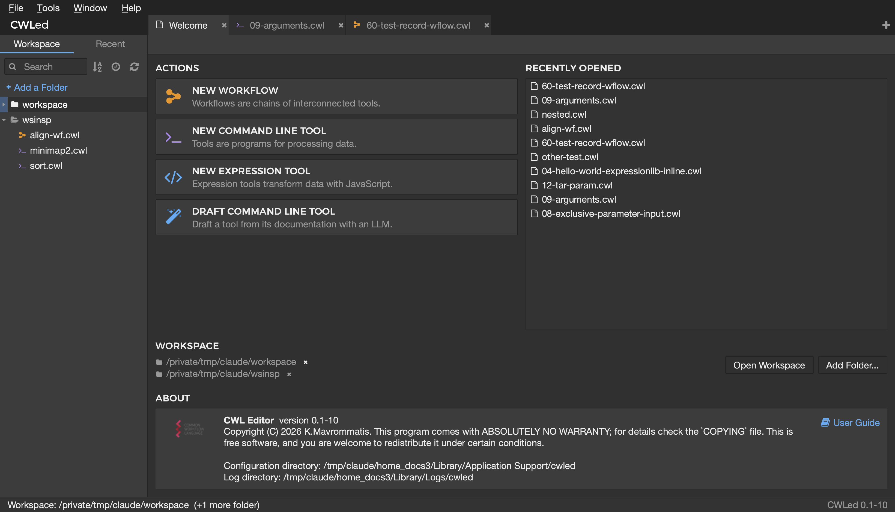

CWLed's main window is laid out like the Rabix Composer editor that inspired it. Document tabs can also be [detached](#detached-windows) into windows of their own, for example to compare two workflows side by side. The window has four areas:

- the **side panel** on the left, with the *Workspace* and *Recent* file lists;
- the **document tabs** across the top, one tab per open document plus the *Welcome* tab;
- the **document area** below the tabs, which shows the editor of the selected document;
- the **status bar** at the bottom.

The application uses a dark colour scheme. Tools are marked with a purple `>_` icon, workflows with an orange "share" icon and expression tools with a blue `</>` icon, both in the side panel and on the document tabs.

## Side Panel

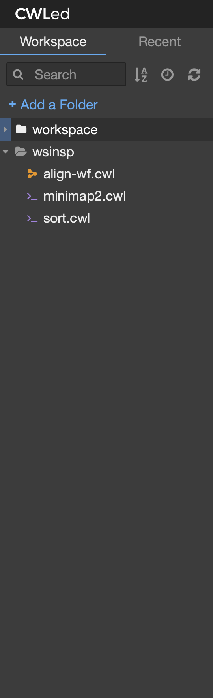

The side panel lists the CWL documents of your workspace. Use the *Workspace* and *Recent* selectors at its top to switch between the two lists.

*Workspace*: A tree of the workspace folders showing the `.cwl`, `.yaml` and `.json` files they contain. Sub-directories are loaded when you expand them. Double-click a file to open it in a new document tab; if the file is already open, its tab is brought to the front instead.

*Workspace folders*: The workspace can hold several folders, as in Composer; each one is a root of the tree. To add one, click **+ Add a Folder** below the search field, or use **File > Add Folder to Workspace...** or **Add Folder...** on the [Welcome tab](#welcome-tab). To remove one, right-click its root and choose **Remove from Workspace**, or click the × next to it on the Welcome tab; this only removes it from the list, files on disk are not touched. A folder that is already in the workspace, or inside one of its folders, cannot be added again, and adding a parent folder replaces the workspace folders it contains. The folders are remembered between sessions; a folder given with `--workspace`, or set as *Workspace* in the [configuration](#paths-tab), is shown first. New files are saved by default in the folder you are working in (the folder of the item selected in the panel, shown in the status bar), and files can only be saved inside a workspace folder.

*Remote folders*: A folder of another machine, for example an EC2 instance, can be added too: click **+ Add a Remote Folder (SSH)** right below **+ Add a Folder** (or **Add Remote Folder...** on the [Welcome tab](#welcome-tab)) (see [Remote Folders (SSH)](#remote-folders-ssh)). Its root is named `host:/path` and has a server icon.

*Search*: Type part of a file or directory name in the search field and press Enter to show only the matching entries of every workspace folder. Clear the field (or press the × inside it) to show the full tree again.

*Sort by name* / *Sort by date modified*: The two buttons next to the search field sort the tree. Clicking the same button again reverses the order.

*Rescan*: Re-reads the workspace folders; the folders of remote machines are read again from the machine too (their first level and the folders you opened, like **Sync from Remote**). The list also updates by itself, a moment after files are added, removed or renamed in a folder that is expanded, and keeps the folders that are expanded, the selection and the scroll position.

*Hidden folders*: Folders whose name starts with a dot, such as the `.steps` folder that **Repackage workflow with all tools** writes, are not listed. The eye button below the search field shows them. Showing a file of a hidden folder (see [Show a Step's File](#visual-editor-tab-1)) turns it on. Version control and cache folders (`.git`, `__pycache__`, `node_modules`, virtual environments) are never listed.

*Follow the open document*: The target button next to the eye button (on by default) selects the file of the document you are working on in the list, when you switch tabs and when a document is opened or saved with another name. It leaves alone the *Recent* list, a search in progress and any folder you hid, and it does not take the selection back from you while you edit.

*Recent*: The files you opened most recently, newest first, each with the icon of its type (workflow, command line tool or expression tool) and its folder in grey. Double-click an entry to open it.

You can also drag a CWL file from the Workspace tree (any of its folders) onto a workflow's Visual Editor to add it as a step (see [Visual Editor Tab](#visual-editor-tab-1)).

## Document Tabs

Every document you open or create gets its own tab. The tab shows the document type icon and the file name (or the document ID for documents that have not been saved yet). A leading `*` in the tab title means the document has unsaved changes. Hover over a tab to see the full path and CWL version of the document.

- Click a tab to switch to that document. Tabs can be dragged to reorder them, or dragged out of the tab bar to [detach](#detached-windows) them into a window of their own.
- Click the × on a tab, or use **File → Close tab**, to close a document. If it has unsaved changes you are asked whether to save them first.
- The **+** button at the right end of the tab bar opens the Welcome tab again if you closed it.

## Detached Windows

To work on several documents at once, for example to compare two workflows, drag a document tab away from the tab bar. The tab leaves the main window for a window of its own, which follows the mouse until you release the button. Drop it anywhere on the screen, next to the main window or on another monitor.

A detached window looks like the main window: it has the **side panel** with a workspace on the left, its own **menu bar**, and the **document tabs** and **status bar**. You can open more files in it from its side panel, create new documents with **File → New**, or drag more tabs into it. Documents can be edited, saved and closed in any window, and a file that is already open is never opened twice: opening it again brings its tab to the front, in whichever window it is.

*Reattaching*: To put a tab back, drag it onto the tab bar of the main window (or of any other window): a blue marker shows where it will land. The window it came from goes away once it has no tab left. Without the mouse, you can right-click a tab and choose **Move to New Window** or **Move to** *another window*, click the button at the right end of the tab bar of a detached window to move all its tabs back to the main window, or choose **Window → Reattach All Tabs to the Main Window**. The only tab of a detached window cannot be torn off again: dragging it moves the window.

*While dragging*: Press Esc to cancel: the tab goes back where it came from (a window that was moved goes back to its place). Drop the window with the pointer at the left or right edge of the screen to make it fill that half of the screen. **Window → Tile Windows Side by Side** (shown while there are detached windows) arranges the main window and the detached ones in a row across the screen; windows that cannot be that narrow overlap a little.

*Link workflow views*: To compare two workflows (or two versions of one), show them in two windows and turn on **Window → Link Workflow Views**, or the link button next to the zoom buttons of the canvas. Panning or zooming one graph then does the same in the graphs of the other windows, by the same amount on the screen, so they stay aligned. Fitting a graph to its window and moving nodes are not linked.

*Workspaces*: Each window has a workspace of its own. A detached window starts with a copy of the workspace folders of the window its tab came from, and the folder of the document is the one you work in. Adding or removing folders in a detached window does not change the workspace of the main window (nor what is remembered between sessions). When a tab moves to another window, **the workspaces are merged**: the folders of the window the tab came from are added to the workspace of the window it goes to (folders that are already there, or inside a folder there, are skipped), so the folders you opened while a window was detached are not lost. The workspace of a detached window that you close instead is dropped.

*Closing*: Closing a detached window closes its documents, asking to save any unsaved changes first. Closing the main window, or quitting, closes every window.

*Next time*: The documents you had open, the windows tabs were torn off into, their positions and sizes and their workspaces are opened again at the next start (documents that were never saved, and files that are gone, are not). Turn this off with *Reopen the documents and windows of the last session at start* in the [General tab of the configuration](#general-tab).

The Welcome tab always stays in the main window.

## Comparing Documents

**Tools → Compare with...**, or **Compare with...** in the menu of a document's tab (right-click it), compares the document with another one and shows the differences in a new tab. You choose what to compare with:

- another document that is open (in any window);
- **The saved version of this document**, to see the changes that are not saved yet;
- a revision of the file in **git** (the last eight commits that changed it, when the file is in a git repository);
- **A file...** that you pick.

The other document is shown on the left and yours on the right. Both are brought to the same form before they are compared, however they were written (as the Code tab shows them, without the address of the file), so only real differences are shown.

- The two texts are side by side, line by line, and scroll together. Lines that differ are coloured (green: only on the right, red: only on the left, amber: different) and a gap faces a line that has no counterpart.
- The list on the left names the **parts that changed**: inputs, outputs, steps, requirements and hints (by id or class) and the other fields. Click an entry to go to it.
- The arrow buttons go to the previous and the next difference.
- For two workflows, **Mark the steps in the graphs** puts a halo around the steps that differ in the Visual Editor of the documents that are open: green for added steps, red (dashed) for removed ones and amber for changed ones. The marks are removed when the comparison tab is closed.
- **Swap the sides** exchanges them; **Compare again** reads the documents and files again, with the changes you made since.

A comparison is a tab like any other: it can be torn off into a window of its own, for example next to the workflows it compares. It is not saved with the session.

## Remote Folders (SSH)

The workspace can hold folders of other machines, typically EC2 instances. CWLed reads the hosts you already have in `~/.ssh/config`, lists the EC2 instances among them, and copies the CWL documents of the folder you choose to your computer. The copy is a workspace folder like any other (search, open, drag onto a workflow, relative paths between workflows and tools all work), and saving a document of it uploads it to the machine again.

**Adding a remote folder**: click **+ Add a Remote Folder (SSH)** right below **+ Add a Folder** in the side panel, or **Add Remote Folder...** next to **Add Folder...** on the Welcome tab, or right-click an empty part of the Workspace tree and choose **Add a Remote Folder (SSH)...**. In the dialog:

- *The hosts*: the EC2 instances of `~/.ssh/config` are listed with their host name, user and why they are taken for EC2 instances (hover a row). **Show all hosts** also lists the other hosts, the filter field narrows the list, and **Reload** reads the file again after you edited it. The file cannot tell an EC2 instance from another machine, so the signs that are looked for are: an Amazon host name (`ec2-1-2-3-4.compute-1.amazonaws.com`, `*.ec2.internal`, an instance id such as `i-0123456789abcdef0`), a ProxyCommand through AWS (Session Manager, EC2 Instance Connect), a comment above the `Host` line or a host name that says EC2 or AWS, and, as *probably*, a `.pem` key or the default user of an Amazon image (`ec2-user`, `ubuntu`...). `Include` files and the settings of `Host *` blocks are followed as `ssh` does. If the file is missing, or none of its hosts looks like an EC2 instance, the dialog says so and lists every host; **Another host** takes any `user@host` that `ssh` understands.
- *Folder on the host*: type a path (`~` is the home folder) or use **Browse...** to walk through the folders of the machine: a double click opens a folder, a click highlights it, and **Choose** takes the highlighted folder (the button says its name) or, when none is highlighted, the folder that is shown. **Test connection** checks that the machine answers and fills in its home folder.
- **Add Folder** copies the documents and adds the copy to the workspace. Errors (the machine cannot be reached, there is no such folder) are shown in the dialog.

**What is copied**: a folder is read one level at a time, so that even a very large one appears at once. When you add it only its first level is read: the `.cwl`, `.yml`, `.yaml` and `.json` documents it holds (not hidden ones, not files over 2 MB) and its sub-folders, which are listed although nothing below them was read yet. A sub-folder is read when you expand it in the Workspace panel (*Loading...* shows under it meanwhile; if the machine cannot be reached it says why, and expanding it again tries again). Hidden folders, `node_modules` and `__pycache__` are never listed, and a level with more than 5000 entries is cut. The copies are kept in the data folder of the application (on macOS `~/Library/Application Support/cwled/remote/<host>/...`), and the folders are remembered between sessions (the `remote_folders` setting): in a later session the folders show what was read before at once, and each is read again the first time you expand it. The search of the panel and **Follow the open document** only know the folders that were read.

**Opening a workflow**: a workflow refers to its tools (and to the sub-workflows and files it imports), usually in other folders, which are not read until you open them. So when you open a document of a remote folder, CWLed first copies the files it refers to and that are not on your computer yet, following what those refer to in turn: the status bar says *Reading the N files that the-workflow.cwl refers to from host:/path ...*, and the document opens when they are here. The tools show in the Workspace panel afterwards. If a file it refers to does not exist on the machine, or the machine cannot be reached, you are told which and why, and the document opens anyway (it may not load). A reference that leads **outside** the remote folder you added (the workflow is in `workflows/` and its tools in `../tools/`, but you added only `workflows/`) cannot be copied: the message says so; add the folder that contains both (a parent folder) as a remote folder.

**Saving and syncing**: saving a document of a remote folder (Save, Save as...) writes it on the machine as well; the status bar says when it is done. If the machine cannot be reached you are told, and the copy on your computer keeps the change. **Sync from Remote** (right-click the root), **File > Sync Remote Folders** and the **Rescan** button of the side panel read the folders again, the first level and the folders you opened, to bring in what changed on the machine. A sync keeps the copy like the machine: a folder or document that was **renamed or deleted** on the machine is removed from the copy too (the old name goes, the new one is listed), unless you changed it here (a document you edited, or one that was never on the machine, is kept). When a file was changed on both sides the newer one wins; one changed only here (an upload that failed) is not overwritten and one changed only on the machine is replaced, whatever the clocks of the two computers say. Deleting a file here does not delete it there. Every folder of the machine is listed, also those that hold no CWL document (they say *No CWL documents* when opened).

**Connecting**: CWLed starts the `ssh` program of your computer with the options of your `~/.ssh/config` (keys, jump hosts, Session Manager proxies and so on), but never asks for a password: the key has to be usable without typing, which means loaded in the ssh agent (`ssh-add`) or without a passphrase, and the host key has to be known already (connect once in a terminal). The machine needs only a POSIX shell with `find`, `tar` and `cat`. What the machine sends back is checked: only plain document files inside the copy of the folder are written.

## Welcome Tab

The Welcome tab is shown when CWLed starts. It contains:

*Actions*: Cards that create a new document in a new tab.
- **New Workflow**: opens the graphical workflow editor, where you build a pipeline by adding existing tools (CommandLineTool and ExpressionTool) as steps and connecting their inputs and outputs.
- **New Command Line Tool**: opens the editor for a CommandLineTool, a wrapper around a command-line program (e.g. samtools, bwa), with fields for the base command, arguments, inputs and outputs.
- **New Expression Tool**: opens the editor for an ExpressionTool, which performs its logic with a JavaScript expression instead of an external program. It is useful for simple data manipulation inside a workflow.
- **Draft Command Line Tool**: drafts a CommandLineTool from the tool's documentation with an LLM (see [Integration with LLMs](#integration-with-llms) and the **Tools** menu).

*Recently Opened*: The same list as the *Recent* side panel. Double-click an entry to open it.

*Workspace*: Lists the workspace folders, each with a × to remove it from the workspace.
- **Open Workspace** shows the Workspace list in the side panel and rescans the folders.
- **Add Folder...** opens a directory selection dialog to add a folder to the workspace (see [Side Panel](#side-panel)).

*About*: The application version, licence notice, the location of the configuration and log directories, and a link to this User Guide.

## Status Bar

The status bar shows the current workspace folder (and how many other folders the workspace has; hover it to see them all) on the left and, on the right, the brush button that switches the [theme](#themes) and the CWLed version.

## Themes

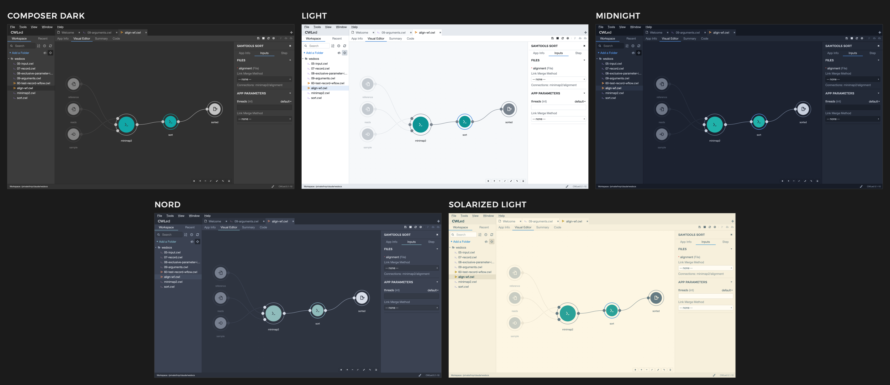

CWLed comes with five colour themes:

- **Composer Dark** (the default): the dark theme of Rabix Composer.
- **Light**: a bright theme with cool greys and blue accents.
- **Midnight**: a deep blue dark theme with bright blue accents.
- **Nord**: the Nord palette, arctic greys with frost blue accents.
- **Solarized Light**: the light variant of Solarized, in warm paper tones.

Choose one with **View > Theme**, the brush button in the status bar, or the *Theme* setting of the [configuration](#general-tab). The theme changes at once, without restarting: the windows, the code editors, the command line preview and the workflow graphs of the open documents are redrawn in the new colours, and the choice is remembered for the next start (the `theme` key of the configuration file). Each theme also has its own code editor colours and workflow graph colours; the themes other than Composer Dark have slightly rounder corners and a dotted grid on the workflow canvas.

# Command Line tool Editor

A CommandLineTool opens in its own document tab. Its editor is organized into three tabs, shown on the left of the bar below the document tabs: **App Info**, **Visual Editor** and **Code**. Each provides a different view and level of control over the tool's definition, so you can switch between editing metadata, configuring the tool's command line and editing the raw source code. For a CommandLineTool, the [command line preview](#command-line-preview) is shown at the bottom of all three tabs.

ExpressionTools use the same editor. Their Visual Editor shows an *Expression* panel instead of the Base Command, Arguments and Other panels, and there is no command line preview.

## Document Toolbar

The buttons on the right of the same bar act on the document:

- **Save**: saves the document (the same as **File → Save**).
- **Repackage**: repackages a workflow with all its tools (workflows only; the same as **Tools → Repackage workflow with all tools**).
- **Reload**: reloads the document from disk.
- **Validate**: validates the document with `cwltool --validate` (the same as **Tools → Validate tool**).
- **Git commit**, **Git push**, **Git pull**: run the corresponding git command for the document's repository. They are enabled when *Track version with Git* is turned on in the App Info tab.

Hover over a button to see its name.

## App Info Tab

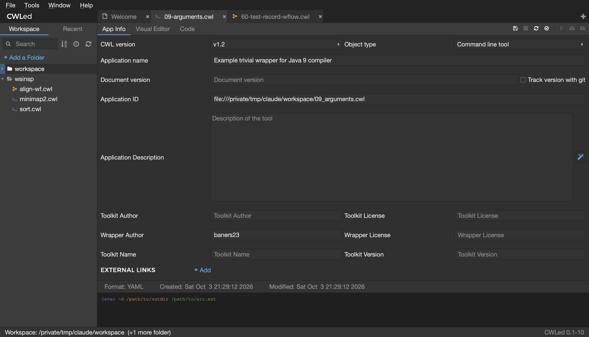
The App Info tab serves as the central location for managing the tool's metadata and documentation. This section is crucial for making the tool understandable, searchable, and easy to use for others. It provides dedicated fields for editing the core descriptive properties of the CWL document.

*Application ID*: A unique identifier for the tool within the workflow.
*Application name*: A short, human-readable name for the tool (the CWL `label`) that is often displayed in graphical interfaces.
*Application Description*: A text field for providing a detailed description of what the tool does (the CWL `doc`), its purpose, and any important usage notes. The magic-wand button next to it generates the description with an LLM (see [AI-Powered Documentation Generation](#app-info-tab-1)).
*CWL Version*: A dropdown menu to select the version of the CWL specification that the tool adheres to (e.g., v1.0, v1.1, v1.2).
*Object type*: Switches the document between a Command line tool and an Expression tool.
*Additional Metadata*: Options to manage extension fields for adding custom metadata annotations that may be required for specific use cases or integrations such as authorship, licensing, or versioning.
*Track Version with Git*: To help you manage the evolution of your CWL documents, the editor includes a powerful "Track Version with Git" feature. When this functionality is enabled, every time you save a CommandLineTool or Workflow, the application automatically performs a git commit and creates a git tag for that specific version of the file. This creates a detailed and robust version history of your document directly within your project's Git repository, allowing you to easily inspect, compare, or revert to any previously saved state. This feature is enabled by default but can be managed in the App Info tab. When active, it works as follows:
*On Save*: When you save a file, the application automatically stages the file in Git.
*Commit Creation*: It creates a new commit with a message like "Autosave version for [your_file_name]".
*Tag Generation*: It then generates a unique version tag and applies it to the new commit. The tag is formatted using the tool's ID and the current timestamp, for example: my-cool-tool/20251117-143005.
The primary benefit of this system is that it provides effortless and granular version control without requiring you to manually run git commands. You can easily retrieve a specific version of your tool by checking out the corresponding tag in your repository (e.g., git checkout my-cool-tool/20251117-143005). This is invaluable for ensuring reproducibility, as it allows you to run a workflow with the exact version of a tool that was used previously. It also provides a safety net, giving you the confidence to experiment with your documents knowing you can revert to any saved point in time.


## Visual Editor Tab

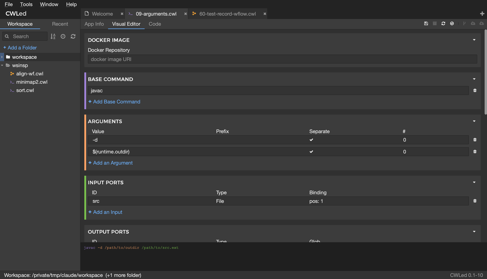

The Visual Editor tab is the heart of the CommandLineTool editor, providing a structured, form-based interface for defining the tool's execution logic. This tab abstracts away the complexity of CWL syntax, allowing you to define how the command is built and what inputs and outputs are expected.

Each part of the tool is shown in its own panel, in the same order as in Rabix Composer. Click a panel's title or the caret on its right to fold or unfold it. The panels for the parts that make up the command line have a coloured stripe on their left, matching the colours of the [command line preview](#command-line-preview): purple for the base command, orange for arguments and green for inputs.

Lists show one bar per entry with the column names above them. Click a bar to edit the entry in the [inspector](#inspector), click the trash icon on its right to delete it, and use the **+ Add ...** link below the list to add an entry (it is added straight away and opened in the inspector).

*Expression fields* (for example *Value Transform*, *Glob* or the stream redirects) have a button attached on their right. A plain value is typed directly and the `</>` button opens the [Expression Editor](#expression-editor). When the field holds a CWL expression (`$(...)` or `${...}`) it is shown greyed out after a bold **E:**; click the field to edit the expression in the Expression Editor, or click the × button to clear it.

*Docker Image*: The *Docker Repository* (image) the tool runs in (DockerRequirement).
*Base Command*: The main executable of the tool (e.g., bwa, samtools, echo), one field per word in the order they appear on the command line.
*Arguments*: Fixed command-line arguments or dynamic ones based on JavaScript expressions, with their *Value*, *Prefix*, whether prefix and value are *Separate* (✔) and their position (*#*).
*Input Ports*: The input parameters of the tool with their *ID*, *Type* (e.g. `File`, `Array<File>`, `string?` for an optional string) and *Binding* (the prefix, `pos: N`, or `unbound` when the input is not on the command line). Optional inputs are shown in grey. Record inputs list their fields below the record.
*Output Ports*: The outputs produced by the tool with their *ID*, *Type* and *Glob* pattern.
*Computational Resources*: Minimum and maximum cores and memory (ResourceRequirement).
*Requirements*: Inline JavaScript with an expression library, ShellCommand and InplaceUpdate requirements.
*File Requirements*: Files and directories staged in the working directory (InitialWorkDirRequirement).
*Environment Variables*: Variables set for the tool (EnvVarRequirement).
*Other*: *Stdin redirect*, *Stdout redirect* and *Stderr redirect* (the `stdin`, `stdout` and `stderr` of the tool, plain file names or expressions) and the exit codes: *Success Codes*, *Temporary Fail Codes* and *Permanent Fail Codes*, each a comma-separated list of numbers.

### Inspector

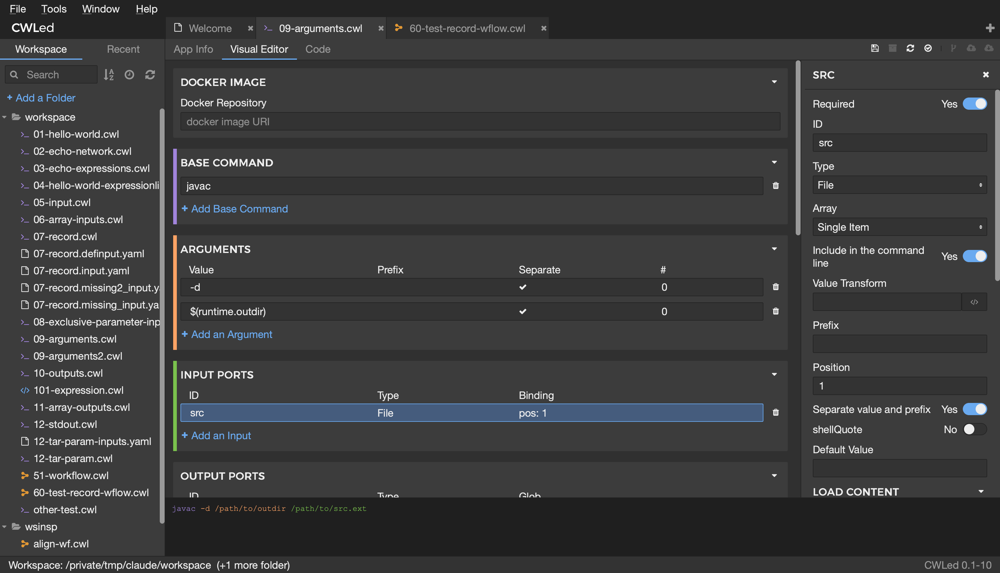

Clicking an argument, input or output opens it in the inspector, a panel on the right of the Visual Editor (as in Rabix Composer). The entry is highlighted in its list and the panel shows its name at the top; the × closes the panel (so does the Escape key). Drag the left edge of the panel to make it wider or narrower.

Changes made in the inspector are applied to the tool as you make them: the list, the command line preview and the Code tab update immediately, and there is no OK or Cancel button. Deleting the entry closes the inspector.

The inspector shows the same settings as the [dialogs](#dialogs), arranged like Composer's: switches with *Yes*/*No* for on/off options, the field label above each field, a `</>` button attached to fields that accept JavaScript expressions, and collapsible sections:
- **Inputs**: *Required*, *ID*, *Type*, *Array*, *Include in the command line*, *Value Transform* (`valueFrom`), *Prefix*, *Position*, *Separate value and prefix*, *Item Separator* (arrays), *shellQuote* and *Default Value*, then the *Load Content* (Files and Directories), *Secondary Files* and *Description* (label, description and file types) sections.
- **Outputs**: *Required*, *ID*, *Type*, *Array*, *Record Field*, *Glob*, then the *Output Eval* (with *Load Content*), *Secondary Files* and *Description* sections.
- **Arguments**: *Prefix*, *Value*, *Separate value and prefix*, *Position* and *shellQuote*.

Expression fields are checked as you type, against the same sample job as the [Expression Editor](#expression-editor): a valid expression shows a dull **E:** in front of it, one that fails shows a red ✖ and a red border instead, and its error appears when you hover the field. The *Stdin*, *Stdout* and *Stderr redirect* fields of the *Other* section are checked the same way.

Inputs of the tool also have a **Test Value** section (as in Composer): the value typed there replaces the input's sample value in the [command line preview](#command-line-preview) and in the Expression Editor. Type a path for a File or Directory, a number, `true`/`false`, one of the symbols of an enum, comma separated values for an array, or JSON (for example a record). Test values are not part of the CWL document: they are kept by CWLed for each file, so setting one does not modify the tool; clear the field to go back to the sample value.

Editing an entry only changes what you edit: settings you did not set (for example *separate*, *shellQuote* or *position*) are not written out with default values, bindings of array items and of enum types stay where they are, and switching an input to *record* and back keeps its command line binding.

### Expression Editor

CWL expressions are written in the Expression Editor, which opens from the `</>` button of an expression field (or by clicking a field that already holds an expression).

- The upper left area is the editor. Write a parameter reference such as `$(inputs.reads.nameroot).bam` or a JavaScript block such as `${ return inputs.threads * 2; }`.
- The area below it shows the result of the expression, evaluated as you type against a sample job, or the error it raises (in red). Expressions are evaluated with the JavaScript engine built into CWLed, so no Node.js installation is needed; an expression that runs for more than 3 seconds is stopped.
- The tree on the right shows what an expression can use: `runtime` (`outdir`, `tmpdir`, `cores`, `ram`, `outdirSize`, `tmpdirSize`), `inputs` (a sample value, or the [test value](#inspector) when one is set, for every input of the tool: for example a File input has a `path` such as `/path/to/<input>.ext`, a `basename`, `nameroot`, `nameext`, ...) and, when editing an input or an output, `self`. Click the arrow of an entry to expand it, and double-click an entry to insert its path (for example `inputs.reads.path`) at the cursor.
- The functions of the tool's *Expression library* (InlineJavascriptRequirement) are available to the expression.
- Typing `inputs.`, `self.` or `runtime.` (or a property after them, such as `inputs.reads.`) lists what can follow; the beginning of `inputs`, `runtime` or `self` completes too. **Ctrl+Space** shows the list at any time. Pick an entry with the arrow keys and Enter (or a click).
- **Save** puts the expression in the field; **Cancel**, the × or Escape close the editor without changing the field.

### Command Line Preview

The panel at the bottom of the editor displays a preview of how the command will be constructed when the tool is executed. This provides immediate visual feedback about how your base command, arguments, and inputs will be assembled into the final command line. The parts are coloured: the base command in purple, arguments in orange and inputs in green, in Composer's monospace font (Courier). To use another font, set `font_family` and `font_size` under `command_line_window` in the configuration file.

As in Rabix Composer, the command line is built from a sample job: every input gets a sample value and the expressions are evaluated with it, so you see the command the tool would run:
- **Sample values**: a `File` input is `/path/to/<input>.ext`, a `Directory` `/path/to/<input>`, a string `<input>-string-value`, a number a small random number (kept while the input keeps its type), a boolean `true` and an enum its first symbol. Arrays have two items.
- **Expressions**: `valueFrom`, arguments and redirects are evaluated against the sample job (`inputs`, `self`, and a `runtime` with 1 core, 1000 MB and `/path/to/outdir` as output directory). An expression that fails is shown as `<error at …>` in red.
- **Arguments and Inputs**: Placed by position, with their prefixes and separators. Array items are joined with the `itemSeparator` (or each gets its own prefix when the item type has an `inputBinding`), record fields with bindings appear with their values, and a boolean shows only its prefix.
- **Redirects**: `< stdin` and `> stdout` at the end.
- **Test values**: an input with a [test value](#inspector) shows it instead of its sample value.
- **Where a part comes from**: hovering a part outlines it and tells which input or argument it comes from (or the error of its expression); clicking it opens that input or argument in the inspector.
- **Optional Parameters**: Displayed in italics to distinguish them from required parameters.

This preview helps you verify that your tool definition will generate the correct command line before running it, making it easier to catch configuration errors early.

## Code Tab

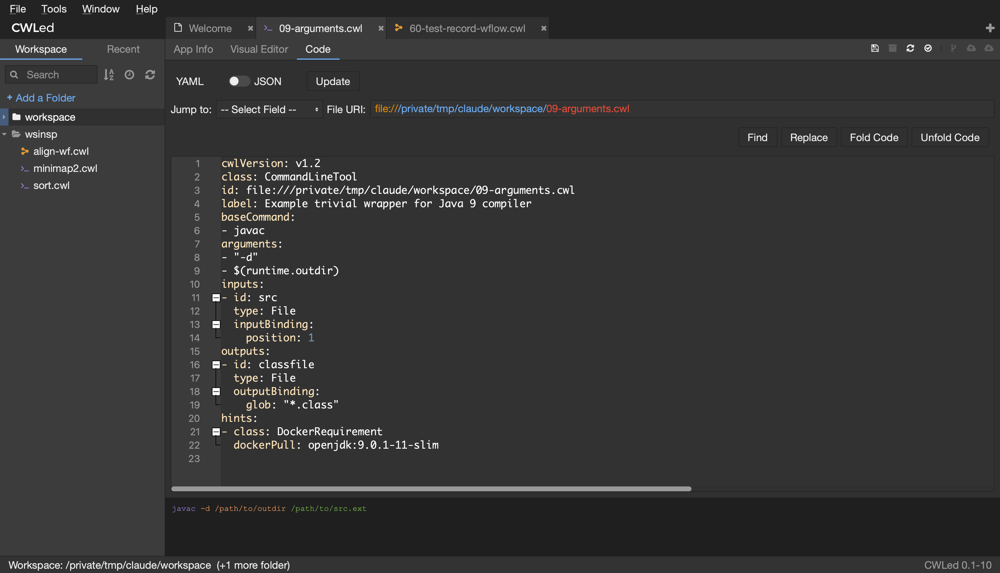

The Code tab provides a direct, unfiltered view of the raw CWL document. It is a fully-featured text editor with syntax highlighting for both YAML and JSON, which are the two formats for serializing CWL.

*YAML / JSON*: The switch at the top selects the format in which the document is shown.
*Update*: Applies your edits to the document. Edits are also applied automatically when you switch to another tab; if the code is not valid, CWLed stays on the Code tab so you can fix it.
*Jump to*: Moves the cursor to a top-level field of the document.
*File URI*: The location of the document.
*Find*, *Replace*, *Fold Code*, *Unfold Code*: Search the text and collapse or expand all blocks. Blocks can also be folded with the markers next to the line numbers.

This tab is indispensable for power users who want to make precise changes, use advanced CWL features not exposed in the GUI, or simply inspect the generated code. Any changes made in the App Info or Visual Editor tabs are instantly reflected in the Code tab, and conversely, any valid edits made in the Code tab will immediately update the other two tabs. This seamless, two-way synchronization ensures that the visual editors and the underlying code are always in perfect harmony, offering the best of both worlds: the simplicity of a GUI and the power of a code editor.


# Workflow Editor

The editor for a CWL Workflow is a powerful, visually-oriented interface designed for composing multi-step analysis pipelines. It allows you to define complex data dependencies and orchestrate multiple tools without needing to write CWL code manually. Like every document, a workflow opens in its own document tab. Its editor is organized into four tabs that provide different ways to view and interact with the workflow: **App Info**, **Visual Editor**, **Summary** and **Code**. A newly opened workflow starts on the Visual Editor tab. The [document toolbar](#document-toolbar) on the right of the tab bar works as for tools, and its *Repackage* button is enabled for workflows.
(Note: For a workflow, the Visual Editor tab shows the graphical workflow editor instead of the form used for a CommandLineTool or ExpressionTool.)

## App Info Tab
The App Info tab is identical in function to the one in the CommandLineTool editor. It is the central place for managing the workflow's metadata and documentation, which is essential for making your pipeline understandable and reusable.

*Application ID*: A unique identifier for the workflow.
*Application name*: A short, human-readable name for the pipeline.
*Application Description*: A detailed description of the workflow's purpose, the analysis it performs, and any important information about its inputs and outputs.

**AI-Powered Documentation Generation**
Next to the Application Description text box in the App Info tab, you will find a button with a magic-wand icon. This is the AI-powered documentation generation feature, designed to help you quickly create high-quality, comprehensive descriptions for your tools and workflows.
When you click this button, the application sends the current state of your CWL document—including its inputs, outputs, and base command—to a Large Language Model (LLM). The AI analyzes this information and automatically generates a detailed documentation string that describes:
The overall purpose of the tool.
A list of the inputs it expects.
A list of the outputs it will produce.
This generated text is then inserted into the documentation box. This feature is incredibly useful for saving time and ensuring your tools are well-documented. Instead of manually writing out every detail, you can generate a robust starting point in a single click and then refine it as needed. It helps maintain consistency and quality in your documentation with minimal effort.

*CWL Version*: A dropdown to select the CWL specification version.
*Namespaces*: Advanced options for defining and managing namespaces for metadata annotation.

## Visual Editor Tab

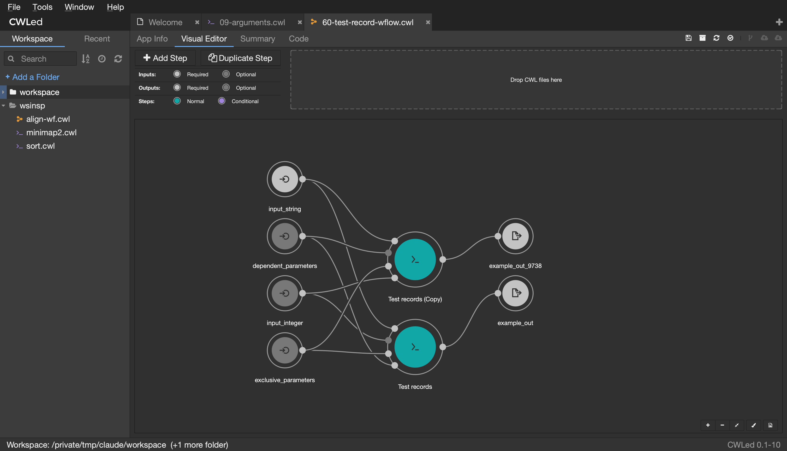

This is the main graphical editor and the most important feature of the workflow editor. It provides an interactive canvas where you can visually construct your pipeline.

*Graph View*: The workflow is drawn the way Rabix Composer draws it. Each step is a circle inside a grey ring: teal, or purple when the step is conditional (it has a `when` expression), with a `>_` icon for command line tools and a branching icon for sub-workflows. Workflow inputs (on the left) and outputs (on the right) are light grey circles, dark grey when optional, with an arrow icon, or a file icon for `File` and `File[]` parameters. Each node's label is shown under it.
*Nodes and Ports*: Ports are the small dots on a node's ring, inputs on the left and outputs on the right. Hover a node to see the names of its ports. As in Composer, a step only shows the ports of its required `File` and `Directory` inputs and of the inputs that are connected; show the port of any other input from the [step inspector](#step-inspector). Drag from an output port to an input port to connect them; drag a port to an empty part of the canvas to create a workflow input or output connected to it. Hover a connection to see which ports it joins.
*Selection*: Click a node to select it: its ring turns teal and everything not connected to it fades. Click a connection to select it and show the names of the ports at its ends. Click the empty canvas to clear the selection, or press Delete to delete what is selected.
*Moving the Canvas*: Press the left mouse button on an empty part of the canvas and drag to move the view, for example after zooming in; the nodes keep their places in the workflow. Dragging a node or a port works as before. Holding **Space** makes a drag move the canvas wherever it starts, even on a node. Scrolling with two fingers on a trackpad moves the canvas, and **Cmd/Ctrl + scroll** or a pinch zooms; the wheel of a mouse zooms. With the canvas selected, the arrow keys move it (hold Shift to move four times as far), **+** and **-** zoom and **0** fits the whole workflow in the view. To select several nodes, hold Shift while you drag a rectangle on the empty canvas, or Shift-click the nodes. Alt + left button and the middle button also move the canvas.
*Canvas buttons*: The buttons at the bottom right of the canvas delete the selection (shown only while something is selected), zoom in and out, fit the whole workflow in the view, auto-arrange the graph and export it as an SVG, PNG or JPEG image. The mouse wheel also zooms; node labels grow as you zoom out so they stay readable. The link button links the view of this graph to the graphs of the other windows (see [Detached Windows](#detached-windows)).
*Adding Steps*: Drag a tool or a workflow from the side panel (*Workspace* or *Recent*), or from your file manager, onto the canvas: it becomes a step where you drop it (a workflow becomes a sub-workflow step and the *SubworkflowFeatureRequirement* is added). The canvas fills the whole editor: there is no toolbar above it.
*Workflow Inputs/Outputs*: You can define the overall inputs and outputs of the entire workflow. This is typically done by "promoting" an input or output from a specific step, making it part of the workflow's public interface.
*Show a Step's File*: Click the **name** of a step (the label under its circle, which is underlined when you point at it) to show the file of the tool or sub-workflow it runs in the *Workspace* side panel of the window: the folders down to the file are expanded and the file is selected. Only the name does this: clicking the circle selects the step, and dragging the name moves the step as usual. A step that is defined inside the workflow shows the workflow's own file. A file that is not in a workspace folder of the window is reported in the status bar. This only moves the selection of the panel; it does not change the folder new files are saved in. **Cmd/Ctrl + click** on the name opens the step instead: the file of its tool or sub-workflow in a tab of the window (or in its tab if it is already open), or, for a step that is defined inside the workflow, its definition in the Code tab with the step selected.
*Step Configuration*: Double-clicking a step (its circle or its name) opens it in the [step inspector](#step-inspector) on the right of the canvas, which stays hidden until then. Double-clicking a workflow input or output opens its [InputDialog](#inputdialog) or [OutputDialog](#outputdialog).

### Step Inspector

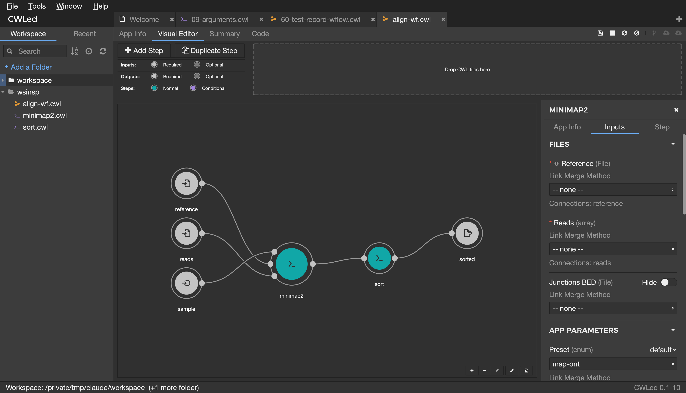

Double-click a step (a tool or a sub-workflow) on the canvas to open it in the inspector on the right of the canvas, as in Rabix Composer. The canvas stays usable while the inspector is open: double-click another step to show it instead, and close the inspector with its × button or Escape. Changes are applied to the workflow as you make them. The workflow requirements a change needs (*ScatterFeatureRequirement*, *InlineJavascriptRequirement*, *MultipleInputFeatureRequirement*) are added automatically. The inspector has three tabs:

*App Info*: The type of the app (CommandLineTool, ExpressionTool or Workflow), its CWL version, the revision, toolkit and author of apps that have them (`sbg:revision`, `sbg:toolkit`, `sbg:createdBy`), its source (the file the step runs, or *Embedded*) and its description.

*Inputs* (shown first): The inputs of the app, `File` inputs under **Files** and the others under **App parameters**. Inputs that the step defines for its `when` condition but the app does not have are listed under **Conditional inputs**. For each input:
- Its label (or ID) and type. A red `*` marks required inputs, and the info icon shows the input's description, suggested value and file types.
- Its port options. An optional `File` or `Directory` input has a *Show*/*Hide* switch that shows its port on the canvas (hiding a port disconnects it). The other inputs have a menu with the input's status:
  - *Default*: the step's default value is used; the port is disconnected and hidden.
  - *Exposed*: the value comes from a workflow input created for it. As in Composer, that input is not drawn on the canvas and is marked `sbg:exposed: true` (the `sbg` namespace is added to the document); its value is given in the job when the workflow runs. Choosing *Default* again removes it.
  - *Port*: the port is shown on the canvas so you can connect it to another node.
- Its default value, edited according to its type: a drop-down for enums, number and text fields, a Yes/No switch for booleans, a field for each field of a record, and a list with *New ...* and delete buttons for arrays. `File` and `Directory` inputs cannot have a default value.
- *Link Merge Method*: none, *Nested* (`merge_nested`) or *Flattened* (`merge_flattened`). In CWL v1.2 documents, inputs with several connections also have *Pick Value* and the order of their sources.
- Its connections, or a warning when its port is on the canvas but not connected (in red when the input is required).

*Step*: The step's *ID* (renaming a step updates every connection to it; an ID that is already used in the workflow or that has invalid characters is refused with a message under the field), *Label* (shown under the node), *Scatter Method*, *Scatter* (the inputs to scatter over: click to select one or more), *When* (CWL v1.2: the condition for running the step, edited with the [Expression Editor](#expression-editor) from the `</>` button; conditional steps are drawn purple), *Description*, and *Set Hints*, which lists the step's hints by class and value and lets you add, edit and delete them.

## Summary Tab

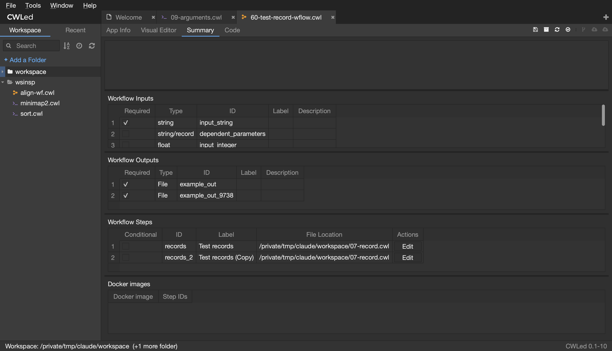

The Summary tab provides a high-level, tabular overview of the workflow's public interface. It is a read-only view designed to give you a quick understanding of what data the workflow requires and what results it will produce, without needing to inspect the internal graph.

*Inputs Table*: Lists all the top-level inputs for the workflow, including their ID, label, data type, whether they are required, and a description.
*Outputs Table*: Similarly, this table lists all the final outputs produced by the workflow, along with their type and description.
*Steps Table*: Lists the steps of the workflow with the file they run. For a step that runs a separate CWL file, the *Edit* button opens that file in a new document tab (it is disabled for tools embedded in the workflow).
*Docker images*: The container images used by the steps.
This tab is particularly useful for quickly verifying the "signature" of your workflow and ensuring all necessary parameters are exposed correctly.

## Code Tab
The Code tab provides a direct, real-time view of the raw CWL source code that is being generated as you build your pipeline in the graphical editor.

*Syntax Highlighting*: The editor supports both YAML and JSON, providing clear syntax highlighting to improve readability.
*Two-Way Synchronization*: This is a key feature. Any action you take in the Visual Editor tab—such as adding a step or connecting nodes—is instantly translated into CWL code that appears here. Conversely, if you are a power user and make a valid change directly in the code, the graphical view in the Visual Editor tab will update to reflect that change. This provides the ultimate flexibility, combining the ease of a GUI with the full power of direct code editing.


# Dialogs

The ArgumentDialog, InputDialog, and OutputDialog are essential components for configuring the details of a tool's arguments, inputs, and outputs. In the Visual Editor of a tool their settings are shown in the [inspector](#inspector) when you click an entry of the Arguments, Input Ports or Output Ports list; in a workflow they open as dialogs when you double-click a workflow input or output (steps open in the [step inspector](#step-inspector)). While they provide a consistent user experience, their behavior and the options they present differ significantly depending on whether you are editing a standalone CommandLineTool or a step within a Workflow.

## ArgumentDialog
The ArgumentDialog is used to define the static or dynamic arguments that are passed to a CommandLineTool.

For a CommandLineTool: This dialog is straightforward. It allows you to define a command-line argument that will be included when the tool is executed. You can specify the argument's position on the command line and its value. The value can be a fixed string or a JavaScript expression that is evaluated at runtime. This is used for arguments that are always the same every time the tool runs.

For a Workflow: This dialog is not used. Workflows do not have "arguments" in the same way CommandLineTools do. A workflow's behavior is defined by the tools it contains and the data flowing between them, not by a list of command-line arguments.

## InputDialog
The InputDialog is used to define the input parameters for a tool or a workflow. This is where the most significant differences in behavior appear.

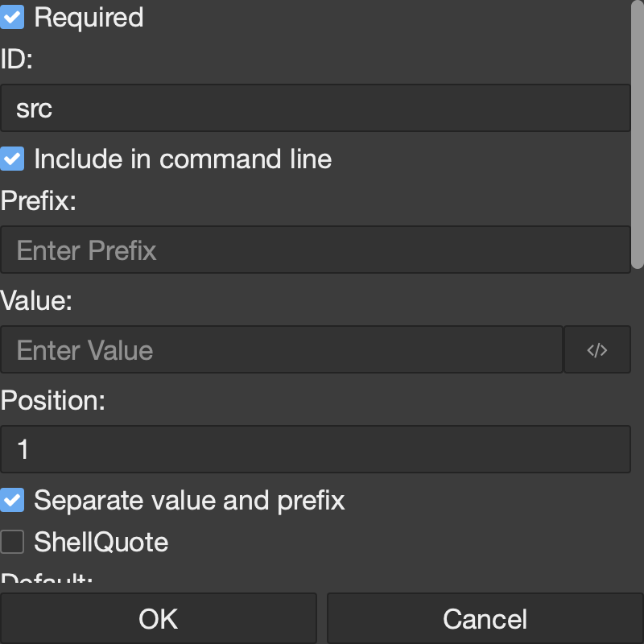

For a CommandLineTool: When editing a CommandLineTool, this dialog allows you to define a new input parameter from scratch. You configure every detail of the input, including:

ID, Label, and Description: The metadata for the input.
Type: The data type (e.g., File, string, boolean, array).
Input Binding: This is a crucial section for CommandLineTools. It defines how the input value is translated into a command-line argument when the tool is run (e.g., by adding a prefix like -i or --input-file).
Include in command line: This checkbox is enabled only when the input has a meaningful inputBinding (for example a non-empty prefix/valueFrom/itemSeparator, a defined position, or enabled separate/shellQuote behavior).
Value from: The Value from field is available regardless of input type, including boolean inputs.
Default Value: A value to use if none is provided when the tool is run.
For a Workflow Step: When used within the workflow editor, the InputDialog's role changes from creation to connection. Instead of defining a new input from scratch, its primary purpose is to link the input of a workflow step to an output from another step or to a main workflow input.

Source Dropdown: The dialog is dominated by a "Source" dropdown menu. This menu is populated with all available data sources within the workflow: the outputs of all previous steps and the main inputs of the workflow itself.
No Input Binding: The "Input Binding" section is absent, as the command-line formatting is the responsibility of the underlying CommandLineTool at that step, not the workflow.
Default Value: You can still set a default value, which will be used if the input is not connected to any source.

## OutputDialog
The OutputDialog is used to define the outputs that a tool or workflow produces.

For a CommandLineTool: When editing a CommandLineTool, this dialog is used to specify how to capture the results of the tool's execution. You define:

ID, Label, and Description: The metadata for the output.
Type: The data type of the output.
Output Binding: This is the key section. You specify how to find the output file(s) after the tool has run, typically by providing a glob pattern (e.g., *.bam) that matches the output files. You can also specify that the output should be captured from the tool's standard output (stdout).
For a Workflow Step: Similar to the InputDialog, the OutputDialog's function within a workflow is about connecting data sources. Its primary role is to define the final outputs of the entire workflow.

Source Dropdown: The dialog features a "Source" dropdown menu that lists the outputs of every step within the workflow. You select one of these as the source for the final workflow output.

**pickValue**: (WorkflowOutputParameter only) This dropdown allows you to control how values are selected when the output source produces multiple values (e.g., from a scattered step). Options include:
- `first_non_null`: Select the first non-null value
- `the_only_non_null`: Require exactly one non-null value, fail otherwise
- `all_non_null`: Include all non-null values as an array

**linkMerge**: (WorkflowOutputParameter only) This dropdown controls how outputs from multiple sources are merged when a workflow output is connected to multiple step outputs. Options include:
- `merge_nested`: Keep values in nested arrays (preserves structure from each source)
- `merge_flattened`: Flatten all values into a single-level array

No Output Binding: The glob pattern and other binding options are not present, because the workflow is simply passing through an output that was already generated by a tool inside it. The responsibility for generating the file and giving it a name lies with the individual tool step, not the workflow's output definition.

# Configuration

The configuration of the program is stored in two configuration files located in the standard configuration directories based on your operating system:
For MacOS: ~/Library/Application Support/cwled
For Linux: ~/.config/cwled/
There are two files:
`cwled.yaml` : The main configuration file storing application settings.
`cwl_env` : A file for storing environment variables, such as API keys for LLM integration.


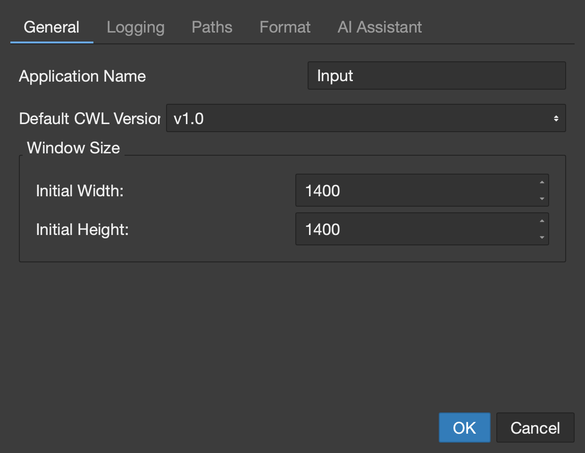

The Configuration dialog allows you to customize various aspects of the application to suit your preferences and environment. It is accessible via **Tools → Configuration** (on macOS: **CWLed → Preferences...**, ⌘,). The settings are organized into several tabs:

## General Tab
This tab contains basic application settings.
*   **Application Name**: The name of the application as displayed in the title bar.
*   **Default CWL Version**: Select the default CWL version to be used when creating new tools or workflows.
*   **Theme**: The colour [theme](#themes) of the application. It is applied as soon as you press OK.
*   **Reopen the documents and windows of the last session at start**: When on (the default) the documents that were open when you quit, the windows tabs were torn off into and their positions are restored at the next start.
*   **Window Size**: Set the initial width and height of the main application window. The window is never opened larger than the screen.

## Logging Tab
This tab allows you to control the verbosity of the application's logs. You can set the logging level (DEBUG, INFO, WARNING, ERROR, CRITICAL) for different components of the application. This is useful for troubleshooting issues or reducing log noise.
After any of these settings are changed, you must restart the application for the changes to take effect.

## Paths Tab
This tab is used to configure important file paths and directories.
*   **Workspace**: The first workspace folder, the default directory where your CWL projects and files are stored. You can browse to select a new location. More folders are added from the side panel or **File > Add Folder to Workspace...**.
*   **CWL Runner**: Configure the commands used to run and validate CWL documents. This includes specifying the executable paths for tools like \`cwltool\` or other runners.
*   **PATH** : You can add additional directories to the system PATH used by the application. This is useful if your CWL tools rely on external executables that are not in the default PATH. e.g. if you have installed nodejs in a custom location, such as a conda environment, you can add that location here so that cwltool can find it when running CWL documents that require node.

## Format Tab
This tab provides options for formatting identifiers.
*   **Sanitize ID Format**: Choose the naming convention used when automatically generating or sanitizing IDs (e.g., for inputs, outputs, or steps). Options include:

- \`camelCase\`, 
- \`UpperCamelCase\`, 
- \`lowerCamelCase\`, 
- \`dash\` (kebab-case),
- \`keeAlphaNum\` (keep alphanumeric only),
- \`underscore\` (snake_case).


# Menu Options

The application provides four menus: **File**, **Tools**, **Window** and **Help**. On macOS they are in the system menu bar at the top of the screen; on Linux they are at the top of the window. [Detached windows](#detached-windows) have the same menus. Commands that act on a document apply to the document whose tab is selected in the window you use them in, and new documents open in that window.

## File Menu

- **Open file...**: Opens a file dialog to select and open a CWL file (supports `.cwl`, `.yaml`, `.json`, `.txt` formats). The file opens in a new document tab, or its tab is brought to the front if it is already open.

- **Save**: Saves the current document to its existing file path. If the document hasn't been saved before, this will open the "Save As" dialog.

- **Save as...**: Opens a file dialog to save the current document with a new name or location. You can choose between JSON or YAML formats with the `.cwl` or format-specific extensions.

- **Reload file**: Reloads the current document from disk, discarding any unsaved changes. A confirmation dialog will ask you to confirm before proceeding. This is useful when the file has been modified externally (e.g., by another editor or version control system) and you want to refresh the view with the latest content from disk.

- **New** (submenu):
  - **Command line tool**: Creates a new document tab for editing a CommandLineTool
  - **Expression tool**: Creates a new document tab for editing an ExpressionTool  
  - **Workflow**: Creates a new document tab for editing a Workflow

- **Recent** (submenu): The most recently opened files.

- **Add Folder to Workspace...**: Adds a folder to the workspace; it appears as a new root in the Workspace side panel (see [Side Panel](#side-panel)).

- **Sync Remote Folders**: Copies the remote folders of the workspace again.

- **Close tab** (Ctrl+W / ⌘W): Closes the selected document tab. If the document has unsaved changes you are asked whether to save them.

- **Exit** (Ctrl+Q): Closes all documents, asking to save any unsaved changes, and quits the application. On macOS this item is **Quit** in the application menu (⌘Q).

## Tools Menu

- **Validate tool**: Validates the current CWL document using `cwltool --validate` (or another validator specified in your configuration). Reports any syntax errors or schema violations.

- **Generate template**: Uses `cwltool --make-template` to generate a template input file for the current tool or workflow. This creates a YAML file with all required and optional inputs pre-populated with placeholder values.

- **Pack workflow to single file**: Packages a workflow and all its dependencies into a single, self-contained CWL document. This is useful for sharing workflows or ensuring reproducibility.

- **Repackage workflow with all tools**: Writes the workflow together with all the tools its steps reference, each step as a separate file under a `.steps` directory. The **Repackage** button of the document toolbar does the same.

- **Save workflow documentation**: Saves an HTML description of the workflow.

- **Upgrade CWL version**: Upgrades the current document to the latest CWL specification version using `cwl-upgrader`. This helps modernize older CWL documents to use newer features.

- **Configuration**: Opens the [Configuration](#configuration) dialog. On macOS this item is in the application menu as **Preferences...**.

- **Reset configuration to default**: Resets all application settings to their default values. This will take effect after restarting the application.

- **Draft CommandLineTool from documentation**: Opens a dialog where you can paste help text or documentation from a command-line tool. The application uses an LLM (Large Language Model) to automatically generate a CWL CommandLineTool definition based on the provided text. The generated file is saved with a `_draft_` prefix and opens in a new document tab for further editing.

- **Compare with...**: Compares the current document with another document, its saved version, a revision in git or a file (see [Comparing Documents](#comparing-documents)).

- **Troubleshoot tool/workflow**: Opens an LLM-assisted troubleshooting flow for the currently active CWL document. You provide an issue description, and the application returns guidance in a dedicated response dialog.


## View Menu

- **Theme**: Switches between the colour [themes](#themes); the current one is checked.

## Window Menu

The Window menu lists all open documents. Each entry shows the document type and its label or ID.

Clicking an entry brings that document's tab to the front, in whichever window it is. This is useful when you have many documents open and their tabs no longer fit in the tab bar.

- **Main Window**: Brings the main CWLed window to the front.
- **Reattach All Tabs to the Main Window**: Moves the tabs of every [detached window](#detached-windows) back to the main window, merging their workspaces. It is shown while there are detached windows.
- **Tile Windows Side by Side**: Arranges the windows in a row across the screen. It is shown while there are detached windows.
- **Link Workflow Views**: Panning or zooming a workflow does the same in the workflows of the other windows (see [Detached Windows](#detached-windows)).

## Help Menu

- **User Guide**: Opens this guide in your web browser.


# Test Files Reference

The files in the `tests/` directory are practical CWL fixtures you can use to test both application behavior and CWL functionality. They cover core features such as command-line bindings, expressions, complex data types, outputs, and workflows. They are largely come from the [CWL userguide](https://www.commonwl.org/user_guide)

- **01-hello-world.cwl**: Minimal CommandLineTool using a default string input bound to `echo`.
- **02-echo-network.cwl**: `stdout` capture to file, output extraction with `outputEval`, and `NetworkAccess` requirement.
- **03-echo-expressions.cwl**: Inline JavaScript with multiple dynamic `valueFrom` argument expressions.
- **04-hello-world-expressionlib-inline.cwl**: Uses `expressionLib` to define and call a reusable JavaScript helper.
- **05-input.cwl**: Mixed input types (boolean, string, int, optional File) with varied `inputBinding` patterns.
- **06-array-inputs.cwl**: Array-input binding styles, including repeated prefixed items and `itemSeparator` joining.
- **07-record.cwl**: Record-typed grouped inputs and an exclusive union of alternative record shapes.
- **08-exclusive-parameter-input.cwl**: Nullable enum choices and returning the selected value via `outputEval`.
- **09-arguments.cwl**: Fixed and runtime-derived arguments, plus file output globbing.
- **09-arguments2.cwl**: JSON-form CWL showing explicit argument fields (`position`, `prefix`, `separate`, `shellQuote`).
- **10-outputs.cwl**: Extracts a specific file from tar with a fixed File output glob.
- **101-expression.cwl**: ExpressionTool that transforms input text to uppercase with JavaScript.
- **11-array-outputs.cwl**: Produces multiple files and collects them as an array File output.
- **11-records.input**: Example input object data for record and exclusive-union parameter tests.
- **12-stdout.cwl**: Dynamic output glob based on a string input to capture a selected extracted file.
- **12-tar-param-inputs.yaml**: Concrete YAML inputs for tar extraction, including CWL File object syntax.
- **12-tar-param.cwl**: Tar extraction with File and positional string inputs, plus dynamic output file selection.
- **50-workflow.cwl**: Two-step workflow chaining external tools and passing step outputs downstream.
- **echo.cwl**: The `echo` step of `50-workflow.cwl`: echoes a message and returns standard output as a string.
- **uppercase.cwl**: The `uppercase` step of `50-workflow.cwl`: ExpressionTool that upper-cases its input.
- **51-workflow.cwl**: Similar two-step workflow with fully inlined CommandLineTool and ExpressionTool definitions.


Attributions
<a href="https://www.flaticon.com/free-icons/save" title="save icons">Save icons created by Yogi Aprelliyanto - Flaticon</a>
<a href="https://www.flaticon.com/free-icons/commit-git" title="commit git icons">Commit git icons created by edt.im - Flaticon</a>
<a href="https://www.flaticon.com/free-icons/commit-git" title="commit git icons">Commit git icons created by HideMaru - Flaticon</a>
<a href="https://www.flaticon.com/free-icons/save" title="save icons">Save icons created by Bharat Icons - Flaticon</a>
<a href="https://www.flaticon.com/free-icons/packaging" title="packaging icons">Packaging icons created by Hilmy Abiyyu A. - Flaticon</a>